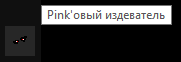
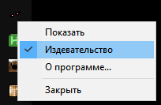

## Pink`овый издеватель

* **Год написания:** 2000
* **Среда разработки:** Delphi 5
* **Статус:** Архив

Одна из многочисленных программ-шуток.

После запуска программа прячется в трее и по кругу проигрывает мелодию из фильма “Розовая пантера” в тяжелой рок обработке. Программа была придумана и отправлена в автозагрузку жертве (он очень любил мультфильм "Розовая пантера").

По правой кнопке по иконке в трее есть выпадающее меню.

Скачать можно в [разделе релизов](./releases).

Скриншоты:

* 
* 
* 

ps. Леха, привет!
